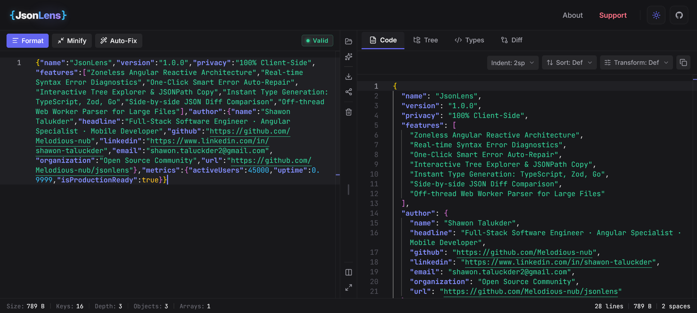
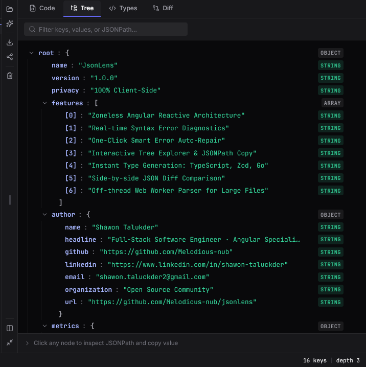
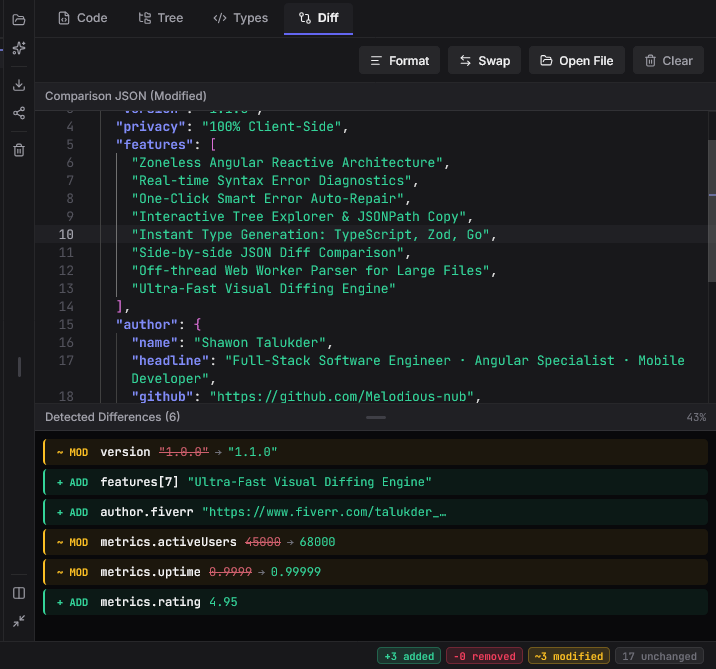
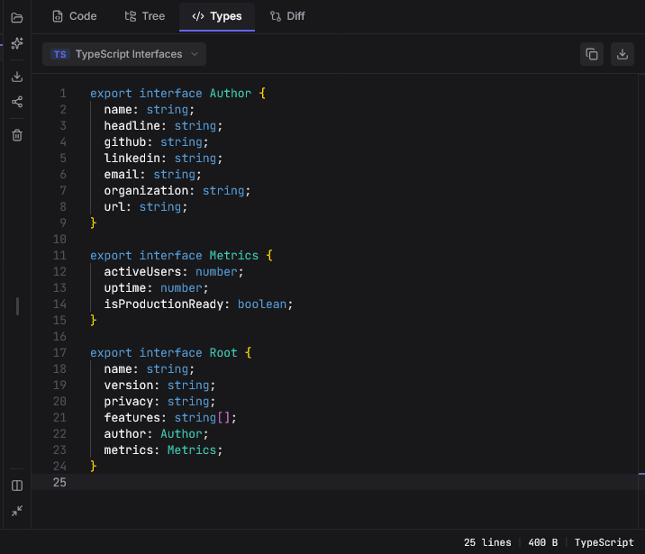

# JsonLens v2.0.0 — The Ultimate Privacy-First JSON Formatter & All-in-One Developer Suite

**JsonLens** is built to be **the best JSON formatter and everyday developer workbench** you need in a single, zero-clutter workspace. Stop switching between five slow, ad-filled websites that leak sensitive API payloads to remote servers—with JsonLens you can format, validate, auto-repair broken JSON, evaluate live JSONPath queries, explore AST trees, run smart semantic diffs, export production reports, generate models across **13 targets**, and share via **offline links or Zero-Knowledge AES-256 encrypted short URLs**, all at desktop speed directly in your browser.

---

## 🖼️ JsonLens Workspace Preview

  

  
  
  

---

## 🌐 Launch JsonLens Web App

Experience the full developer suite directly in your browser with SSR-fast loading and PWA support:

**Dedicated Tool Routes:**
- `/` — JSON Formatter & Beautifier
- `/json-validator` — JSON Validator & Smart Auto-Repair
- `/json-minifier` — JSON Minifier & Payload Compressor
- `/json-to-typescript` — JSON to TypeScript, Zod & 13-Target Converter
- `/json-diff` — Side-by-Side Visual JSON Diff & RFC 6902 Patch Comparison

> 💡 **Privacy Guarantee:** Every parse, repair, diff, type conversion, and export executes **100% inside your local browser sandbox**. Even optional Short URLs are encrypted client-side with **AES-256-GCM** before leaving your device.

---

## 🌟 Why Developers Choose JsonLens Every Day

Most online JSON formatters either upload confidential customer/token payloads to third-party servers, freeze on 2MB+ API dumps, or force you to open separate tabs for formatting, diffing, JSONPath testing, and schema generation.

**JsonLens unifies every day-to-day JSON workflow in one cohesive suite:**
1. **Desktop-Grade Speed (Even on Multi-MB Files):** Powered by Monaco Editor (VS Code's engine), Angular 22 Zoneless Signals, virtualized rendering, and an automatic **Web Worker** off-thread parser for payloads over 2 MB.
2. **True Privacy by Design:** Zero payload tracking, zero third-party analytics, offline `#d=` compression links, and optional **Zero-Knowledge AES-256-GCM Short URLs** where the decryption key never touches the server.
3. **Zero Context Switching:** Edit raw or broken JSON on the left while inspecting formatted output, interactive AST trees, generated code types, or live diffs side-by-side on a resizable (`0%–100%`) split workspace.

---

## ✨ Complete Feature Breakdown

### ⚡ Monaco Editor & Code Lens
Engineered for high-density daily editing and reading:
- **Compact Unified Toolbar:** Streamlined 29px sub-headers across every Output Lens (`Code`, `Tree`, `Types`, `Diff`) maximize vertical coding space.
- **Icon-First Primary Toolbar:** Clean, responsive icon controls for **Format**, **Minify**, **Open File** (`.json` or drag-and-drop), **Load Sample**, **Export**, **Share**, **Clear**, typography sizing, and fullscreen mode.
- **Exact Error Diagnostics:** Live status bar and inline Monaco markers highlighting line, column, syntax reason, total byte size, key count, max nesting depth, object/array breakdown, and primitive counts.
- **Flexible Formatting:** Switch non-destructively between **2 Spaces**, **4 Spaces**, **Tabs**, and **Minified** output.
- **Sorting & Structural Transforms:** Sort object keys **Ascending (`A–Z`)** or **Descending (`Z–A`)**, **Flatten** deeply nested objects to dot-notation, **Unflatten** dotted keys back into nested structures, or **Strip Null Values** cleanly.

### 🔧 One-Click Smart Syntax Auto-Repair
Paste broken logs, JavaScript objects, or Python dicts and fix them in one click (`Alt + R` or Auto-Fix icon button):
- Quotes unquoted object keys.
- Converts single quotes to RFC 8259 double quotes.
- Strips trailing commas in objects and arrays.
- Translates Python/JS literals (`True`, `False`, `None`, `undefined`) to valid JSON (`true`, `false`, `null`).
- Resolves unescaped newlines and missing/unbalanced brackets & braces.

### 🌳 Interactive AST Tree Lens & Live JSONPath Evaluator
Navigate complex API responses effortlessly:
- **Instant Tree Search & Auto-Expansion:** Filter by key or value with live match counts and automatic branch expansion.
- **Live JSONPath Query Bar:** Type JSONPath expressions (e.g. `$.features[*]`, `$.author.name`) directly in the filter box to evaluate matches in real time with a **1-click Copy Query Result** button.
- **Breadcrumb Inspector & Copy Actions:** Select any node to inspect its full JSONPath and data type badge, then copy either the **JSONPath** or **formatted node value** in one click.
- **Expand / Collapse All:** Quickly expand or collapse nested subtrees with synced command versioning.

### ⚖️ Semantic Visual Diff Lens
Compare API versions, staging vs. production responses, and database snapshots side-by-side:
- **Semantic AST Diffing & Inline Decorations:** Highlights added (`+ ADD`), removed (`- DEL`), and modified (`~ MOD`) lines across both left and right Monaco editors with synchronized color gutters.
- **Smart Array Matching Mode:** Toggle between strict index-by-index comparison and **Smart Array Matching**, which aligns inserted/deleted array objects cleanly to eliminate noisy cascading diffs.
- **Collapsible Resizable Differences Drawer (`0%–100%`):** Drag the divider smoothly or double-click/toggle between `0%` collapsed and `50%` open.
- **Click-to-Jump & Dedicated Copy Path:** Click any diff entry in the list to jump directly to the exact line numbers in both editors with a visual pulse highlight, or use the dedicated trailing **Copy Path** icon button.
- **Filter, Search & Report Exports:** Filter by change type (`All`, `Added`, `Removed`, `Modified`) and path query, copy an **RFC 6902 JSON Patch**, or download clean **Markdown (`.md`)** and **Plain Text (`.txt`)** diff reports.
- **Smart Baseline Auto-Sync & Swap:** Swap left/right payloads, load an external `.json` comparison file, auto-repair invalid comparison JSON, or auto-sync new baselines after clearing.

### 🏷️ 13-Target Type & Schema Generator
Convert any valid JSON payload into clean, idiomatic models ready for your codebase:
- **TypeScript** (`interfaces`)
- **Zod** (recursive runtime validation schemas)
- **JSON Schema** (Draft specification)
- **JavaScript** (JSDoc typedefs / shapes)
- **Python** (`TypedDict` classes)
- **Java** (POJOs with `@JsonProperty`)
- **Kotlin** (`data class` with `@SerializedName`)
- **Dart** (typed model classes)
- **C#** (`.NET` classes / properties)
- **Go** (`struct` definitions with `json:` tags)
- **Rust** (`serde` `#[derive(Serialize, Deserialize)]` structs)
- **PHP** (typed classes)
- **Swift** (`Codable` structs)
- **Custom File Export:** Copy generated code in one click or save with a custom filename via the inline **Download Dropmodal**.

### 🔗 Privacy-First Workspace Sharing, E2EE Short URLs & QR Lightbox
Collaborate across laptops and phones without sacrificing confidentiality:
- **Instant Link (`Private` — Default Recommended):** Compresses minified JSON into compact `#d=` URL hash fragments (`40%–76%` smaller links). Per RFC 3986, URL fragments are **never transmitted to any server**.
- **Optional Short URL (`E2EE` — Zero-Knowledge AES-256-GCM):** Generate short branded links (`?s=<id>#k=<key>`) in one click:
  - Your browser compresses and encrypts JSON locally with a random **256-bit AES-GCM** key before uploading ciphertext to Cloudflare D1 (`/api/s`).
  - The decryption key stays exclusively in the URL `#k=` fragment—even our server cannot read your data.
  - Stored ciphertexts auto-expire after **30 days** with zero IP or user-agent logging.
- **Interactive QR Previewer Lightbox & High-Res PNG Download:** Generates crisp QR codes synced to whichever share tab is active, featuring smooth wheel zoom (`40%–350%`), drag-to-pan, double-click zoom, and 512px PNG download.

### 📤 Multi-Format Workspace Exports
Download and share artifacts cleanly in one click:
- **Formatted `.json`**
- **Flattened `.csv`**
- **Professional A4 `.pdf` Report** (generated client-side via `jsPDF` with byte/key/depth statistics)
- **Typed Code Files** (`.ts`, `.go`, `.py`, `.rs`, etc.)
- **Diff Reports** (`.md`, `.txt`, and RFC 6902 JSON Patch clipboard copy)

### 🌓 5 Developer Themes, Ripple Transitions & Dynamic Font Scaling
- **5 Curated Themes:** Switch smoothly between **Dark**, **Light**, **Tokyo Night**, **Dracula**, and **Nord**.
- **GPU Circular Ripple Transition:** Powered by the browser's View Transitions API (`clip-path` wave animation expanding directly from the theme toggle).
- **Central `Aa` Typography Controller:** Adjust font sizes (`11px Compact` to `18px Huge`, `1px` step controls, quick reset) across all Monaco editors and the Tree Lens DOM hierarchy simultaneously, persisted in `localStorage`.

---

## 🛠️ Architecture & Tech Stack

- **Framework:** Angular `22.2+` (Standalone Components, SSR & Prerendering via `@angular/ssr`, Zoneless-ready)
- **Reactivity:** Angular Signals (`signal`, `computed`, `effect`, `model`, `input`, `output`)
- **Change Detection:** Strict `ChangeDetectionStrategy.OnPush` everywhere
- **Editor Engine:** Monaco Editor `0.57+` with virtualized scrolling
- **Worker Offloading:** Dedicated background Web Worker for parsing payloads >= 2 MB
- **Edge Functions (Privacy-Hardened):** Cloudflare Pages Functions + Cloudflare D1 (`functions/api/s.ts` for Zero-Knowledge ciphertext storage, `functions/api/stats.ts` for anonymous telemetry)
- **Verification:** Strict TypeScript 6 (`noImplicitAny`, strict templates) + Vitest suite (**40 test files / 243 passing tests**) + CI checks on every push

---

## 🚀 Quick Usage Guide

1. **Paste or Load JSON:** Drop a `.json` file anywhere into the editor, click **Open File**, or click **Sample**.
2. **Format or Repair:** Press `Alt + F` to prettify, `Alt + M` to minify, or `Alt + R` / **Auto-Fix** to repair broken syntax.
3. **Transform Output:** Switch to the **Code** tab to pick indentation (`2 Spaces`, `4 Spaces`, `Tabs`, `Minified`), sort keys (`A-Z`/`Z-A`), or apply `Flatten` / `Unflatten` / `Strip Nulls`.
4. **Query & Inspect Tree:** Open the **Tree** tab to search keys/values, run live JSONPath queries (`$.features[*]`), and copy exact paths or values.
5. **Compare Payloads:** Switch to the **Diff** tab to edit/load a comparison payload, toggle **Smart Array Matching**, filter changes, click diffs to jump straight to line numbers, and export `.md`/`.txt` reports or RFC 6902 JSON Patches.
6. **Generate Types:** Open the **Types** tab, pick any of the **13 targets**, and copy or download the generated file.
7. **Share Securely:** Click **Share** on the center rail to copy your offline **Instant Link (`#d=`)**, switch to **Short URL (`E2EE`)** for a compact AES-256 encrypted link, or view/download a **QR Code**.

---

## ⌨️ Keyboard Shortcuts

| Shortcut | Action |
| :--- | :--- |
| `Alt + F` / `Shift + Alt + F` | Format JSON (Prettify) |
| `Alt + M` | Minify JSON (Compact Single-Line) |
| `Alt + R` | Auto-Fix Broken JSON Syntax |
| `Ctrl + F` / `Cmd + F` | Find in Active Editor (Left Input or Right Output) / Tree Filter |
| `Double Click Splitter` | Reset Split Panels to Center (`50% / 50%`) |
| `Double Click / Tap Diff Grip` | Toggle Differences Drawer (`0%` Collapsed / `50%` Open) |
| `Enter` / `Space` (Diff Header) | Toggle Differences Drawer Collapse / Open |
| `Esc` | Dismiss Open Popover, Search Widget, Fullscreen, or Image Lightbox |
| `+` / `-` | Zoom In / Zoom Out (QR Lightbox) |
| `0` | Reset Zoom & Pan to `100%` (QR Lightbox) |
| `Double Click Image` | Toggle Zoom (QR Lightbox) |

---

## 🛡️ Privacy & Security

JsonLens is architected from the ground up for sensitive developer data:
- **100% Client-Side Core:** Formatting, syntax validation, auto-repair, JSONPath queries, AST diffing, type generation, and PDF/CSV exports never touch a backend server.
- **Offline Hash Sharing (`Instant Link`):** Encodes payloads inside `#d=...`, which browsers never transmit in HTTP requests.
- **Zero-Knowledge Encrypted Short URLs (`Short URL`):** Encrypted client-side using Web Crypto **AES-256-GCM** before upload. The server stores only ciphertext + a 30-day expiry timestamp; the decryption key stays strictly inside `#k=...`.
- **No Cookies, Ads, or Trackers:** No Google Analytics, no third-party ad beacons, and zero IP address storage.
- **Minimal Anonymous Telemetry:** Uses `/api/stats` with an ephemeral random session ID solely to show live active users and visit counts on the About page.

---

## 📄 License

Licensed under the **MIT License** — see [LICENSE](LICENSE) for full details.

---

## 👨💻 Developer & Connect

  <strong>Shawon Talukder</strong> 
  <em>Software Engineer at Green Delta Insurance PLC</em>

Built for developers who care about craftsmanship, speed, and privacy. Contributions, bug reports, and feature ideas are always welcome!

---

  Developed with ❤️ for the Developer &amp; Open-Source Community.

